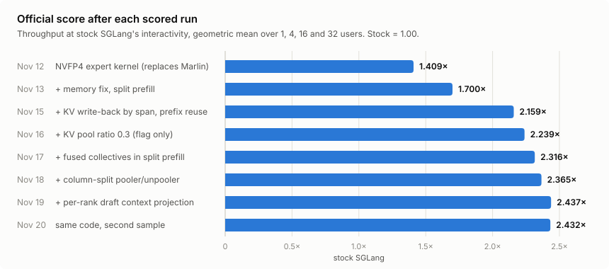
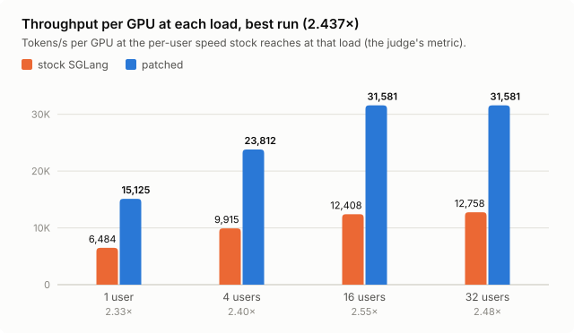

# Muse Spark Open Kernel Challenge: an engineering post-mortem

Serving an 816B-parameter NVFP4 mixture-of-experts model on 8×H200, measured against stock SGLang by the organizers' judge.

**Result.** The final SGLang patch reaches **2.437×** stock SGLang's throughput at stock's interactivity (geometric mean over 1, 4, 16 and 32 concurrent users), with outputs that pass the judge's agreement gates and 2.0 GB less GPU memory per GPU than stock. A second sample of the same code scored 2.432×.

**What this repository is.** A mid-table entry written up as an engineering record, not a winning one. It holds the patches exactly as the judge ran them, the judge's receipts for every scored and check run, and the experiments that failed with the reason each one failed. The serving leaderboard was still private when this was written (2026-11-26), so the final rank is unknown, and all positions are provisional until the organizers finish their review.

<picture>
  <source media="(prefers-color-scheme: dark)" srcset="docs/img/score_by_run_dark.svg">
  
</picture>

| | |
|---|---|
| Challenge | [Muse Spark Open Kernel Challenge](https://openkernelchallenge.dev/) (Paradigm, Meta, Andromeda), Oct 22 to Nov 19, 2026, Pacific time. The serving track closed at 07:59 UTC on Nov 20 |
| Serving track | 8 scored runs, 17 check runs, every one passed the output-agreement gates |
| Kernel track | 5 problems, 623 judged runs recorded. The board entries are public Apache-2.0 kernels plus this project's changes; they rank 164 to 324 out of 896 to 1,741 |
| Hardware | The judge's 8×H200 node. Local development on one 8 GB laptop GPU, plus short rented sessions on 1×H200, 2×H200 and 4×H100 |
| Team | One person, working through AI coding agents (see [How this was built](#how-this-was-built)) |

## Contents

1. [Baseline](#1-baseline)
2. [Where the time went](#2-where-the-time-went)
3. [What was tried, in order](#3-what-was-tried-in-order)
4. [Results and how to reproduce them](#4-results-and-how-to-reproduce-them)
5. [Kernel track](#5-kernel-track)
6. [Method](#6-method)
7. [What I would do differently](#7-what-i-would-do-differently)
8. [Provenance and credits](#provenance-and-credits)

## 1. Baseline

**System under test.** SGLang v0.5.23 (commit [`297e54fd`](https://github.com/sgl-project/sglang/commit/297e54fd105e974cdf401e5b4d20253a22c16f90)) serving `Muse-Spark-Open-816B-A42B-NVFP4` on one node with 8 H200 GPUs: tensor and expert parallelism of 8, speculative decoding with the DFlash draft model (8 draft tokens per step), FP8 KV cache, hierarchical KV cache on, 16,384-token prefill chunks.

**Workload** (as the judge reports it). Multi-turn conversations of 13 turns. The first turn carries 74,160 prompt tokens; each later turn adds 753 new tokens; each turn generates about 220 tokens. 92 % of prompt tokens hit the prefix cache. The same conversations are replayed at 1, 4, 16 and 32 concurrent users.

**Metric.** At each load the judge measures stock's per-user speed, reads the patched server's throughput at that same per-user speed off its measured throughput/interactivity frontier, and divides by stock's throughput. The score is the geometric mean of the four ratios, so stock scores 1.00. Stock and the patch run on the same node in the same job.

**Stock SGLang, measured by the judge next to the best run:**

| concurrent users | tokens/s per GPU | tokens/s per user |
|---|---|---|
| 1 | 6,484 | 141.2 |
| 4 | 9,915 | 56.8 |
| 16 | 12,408 | 17.5 |
| 32 | 12,758 | 9.0 |

Across the eight scored runs stock's throughput moved by at most 2.6 % at any load (for example 6,440 to 6,512 tokens/s per GPU at 1 user). Stock's memory per GPU: 69.85 GB of weights, 37.6 GB of KV cache holding 1,889,034 tokens, 15.8 GB of prefill CUDA graphs.

The judge does not report GPU utilization, and it reports stock's time to first token only as a limit (a patch may not exceed twice stock's), so neither appears here as a baseline number.

## 2. Where the time went

The analysis below was done on the second scored run (score 1.700) and drove everything after it.

**Server time per conversation.** A conversation generates 2,860 tokens, so `2860 / (users × tokens/s per user)` is the server time one conversation costs. That turns the judge's numbers into seconds that can be attributed:

| users | stock | patch at 1.700 | of which first-turn phase | of which steady phase |
|---|---|---|---|---|
| 1 | 20.37 s | 14.74 s | 2.5 to 3.0 s | 11.8 to 12.2 s |
| 4 | 12.75 s | 8.45 s | 3.16 s | 5.30 s |
| 16 | 10.39 s | 6.16 s | 3.22 s | 2.94 s |
| 32 | 9.93 s | 5.77 s | 3.52 s | 2.24 s |

**Bottom-up attribution.** Each line of work was then priced from separate measurements: single-GPU layer benchmarks, a 4-GPU bench for the collectives, a one-GPU bench for the draft model.

- **At 1 user the account closes.** The measured decode step (14.4 ms) is 11.0 to 13.3 ms of target-model layers, 1.2 to 1.4 ms of draft-model forward and 0.2 ms of draft KV commit.
- **From 4 users up it does not.** Between 1.1 and 2.6 s per conversation, 13 to 44 % of the total, had no source in the GPU layers.
- **Ruled out by measurement:** a per-request cost in the speculative-decoding runtime (three causal hypotheses, each under 0.15 ms), the draft model's attention, CPU scheduling of the step, and the all-reduces as pure transfer.

**What the unattributed time turned out to be:**

- **KV write-back on the CPU.** With the hierarchical cache on, the scheduler spent about 20 µs of CPU per prefilled token copying KV pages one call at a time. Copying each contiguous span in one call (a 15-line change) raised throughput at 32 users from 21,570 to 27,171 tokens/s per GPU, measured in isolation by a check run.
- **KV evictions at 32 users.** The sliding-window layers were given 80 % of the full-attention pool although they hold far fewer tokens, so only 23 of 32 conversations stayed resident and evicted ones were re-prefilled on every turn. One launch flag (`--swa-full-tokens-ratio 0.3`) raised capacity from 1.98 to 3.12 million tokens and cut later-turn time to first token at 32 users from 1.69 s to 0.57 s.
- **The first-turn wave.** A 74,160-token first turn takes about 2.1 s of prefill and first turns are served one after another, so at 32 users the 90th-percentile first-token wait is 68 s. This is the largest remaining cost and the one this project did not solve (see section 7).

**Inside the expert kernel.** The model's routed experts use 4-bit NVFP4 weights; stock SGLang runs them on Hopper through the generic Marlin W4A16 path. A profile of an early version of the replacement kernel at 32 tokens (148 µs per call) shows where its time goes: streaming the packed weights from memory alone takes 116.5 µs, the matrix multiplies 16 µs, the epilogue 9 µs, re-streamed activations 4 µs and weight decoding 1 µs. The kernel is a weight-streaming problem, not an arithmetic one, and GPU-scope memory fences issued by threads on a receiving SM stall the stream (2.2 µs with 64 KB in flight, 6.3 µs with 128 KB).

## 3. What was tried, in order

Each scored run had a numeric forecast and a falsifier written down before it was sent.

| # | Submitted (UTC) | Change | Forecast | Official score | Reading |
|---|---|---|---|---|---|
| 1 | Nov 12 | NVFP4 expert kernel for Hopper in place of Marlin | 1.64 | 1.409 | **Forecast wrong by 14 %.** See the first failure below |
| 2 | Nov 13 | Weight-repack memory fix, sequence-parallel (split) prefill | 1.61 | 1.700 | Confirmed |
| 3 | Nov 15 | KV write-back by span, prompt-prefix reuse in tokenization | 1.90 | 2.159 | Confirmed, 14 % above the forecast |
| 4 | Nov 16 | KV pool ratio 0.3 (flag only) | 2.23 | 2.239 | Confirmed, all seven predictions inside their intervals |
| 5 | Nov 17 | Fused collectives in the split prefill | 2.35 | 2.316 | Positive, smaller than forecast |
| 6 | Nov 18 | Column-split pooler/unpooler projections on decode steps | 2.375 (2.313 to 2.399) | 2.365 | Confirmed |
| 7 | Nov 19 | Draft model's context projection applied per rank | 2.384 (2.372 to 2.404) | **2.437** | Above the interval |
| 8 | Nov 20 | Same code, one source comment reworded | 2.405 (2.37 to 2.44) | 2.432 | Second sample of run 7 |

Per-patch notes, file lists and hashes are in [serving/README.md](serving/README.md).

### What did not work

- **The first scored run missed its forecast by 14 %.** Repacking the weights for the new kernel left 59 allocator fragments of 224 MiB per GPU, 12.9 GB in all, counted as weights. The KV cache shrank from 1.89 to 1.23 million tokens, the 16-user rung was excluded for a later-turn time to first token of 0.78 s (limit: twice stock's 0.34 s), and at 32 users it reached 4.34 s. The kernel was fine; the loader was not. Releasing the allocator cache before each layer's repack instead of after it brought the weights back from 82.7 to 69.8 GB. The forecasting simulator was also rebuilt on the judge's real metric and workload.
- **Prompt-prefix reuse in tokenization gave nothing measurable.** Forecast: later-turn time to first token from 0.16 s to 0.08 s. Measured: 0.163 s. A later check showed a related change was inert on the judge because the judge does not send text through that path. The code is correct and still ships in the final patch, where about 220 lines buy nothing that was measured.
- **Row-local prefill (keeping per-rank rows instead of replicating work across GPUs) did not transfer from 2 GPUs to 8.** On a 2-GPU bench it saved 48 to 54 ms per prefill chunk. Three official checks at 32 users gave +0.005 %, -0.23 % and +0.63 % against a run-to-run noise of ±0.66 %. The cause at 8 ranks was not identified. Dropped.
- **A larger draft block (16 tokens instead of 8) did not raise acceptance.** Accepted tokens per step went from 4.2 to 4.30; the break-even needed 5.3. Dropped.
- **A rented H200 could not reproduce the kernel judge's absolute timings.** Calibration runs were off by -4.5 % to +8.5 %. Rented GPUs were used only for A/B comparisons on the same machine after that.
- **A tiny-model bench could not compare outputs under staggered load**, because with synthetic weights the outputs depend on batch composition. It stayed in use for functional tests only.
- **The hunt for a per-request runtime cost found none.** Three causal hypotheses were tested on one GPU and then at 1 and 4 ranks; each explained under 0.15 ms. A planned rewrite of the runtime was not started on that basis.
- **Fused collectives delivered about two thirds of the forecast gain** (+0.077 against +0.11).

Kernel-track failures are in [kernels/README.md](kernels/README.md).

## 4. Results and how to reproduce them

### Best run, per load

<picture>
  <source media="(prefers-color-scheme: dark)" srcset="docs/img/throughput_by_load_dark.svg">
  
</picture>

| users | stock tokens/s per GPU | patch at stock's per-user speed | ratio | patch as measured: tokens/s per GPU, per user | first token p90, first turn | first token p90, later turns |
|---|---|---|---|---|---|---|
| 1 | 6,484 | 15,125 | 2.333 | 10,771 at 232.7 | 3.50 s | 0.16 s |
| 4 | 9,915 | 23,812 | 2.402 | 18,741 at 106.8 | 7.89 s | 0.18 s |
| 16 | 12,408 | 31,581 | 2.545 | 27,463 at 39.2 | 31.22 s | 0.24 s |
| 32 | 12,758 | 31,581 | 2.475 | 31,581 at 23.0 | 68.09 s | 0.57 s |

Job `19289d345d3c4640`, patch sha256 `c25c4a1e…8c49`, flags `--enable-layernorm-sp --swa-full-tokens-ratio 0.3`.

### Before and after

| | stock SGLang | best run |
|---|---|---|
| Score | 1.00 | 2.437 |
| Prefill KL against stock (limit 0.11) | | 0.049 |
| Decode KL against stock (limit 0.035) | | 0.013 |
| Agreement with stock, first turns / later turns (minimum 0.85 / 0.92) | | 0.96 / 0.97 |
| GPU memory per GPU against stock (limit +2 GB) | | -2.0 GB |
| KV cache capacity, tokens | 1,889,034 | 3,072,281 |
| Prefill CUDA graph memory per GPU | 15.8 GB | 14.7 GB |
| Patch size | | 146.5 KB, 18 files, all under `python/sglang/` |

**Noise.** Two runs of the same code gave 2.437 and 2.432. Raw throughput at 1 user differed by 8 % between them (10,771 and 9,924 tokens/s per GPU), while the ratio to stock, measured on the same node in the same job, differed by 0.05 % at 1 user (2.3325 and 2.3314) and by at most 1.0 % at any load. Raw low-load throughput is not comparable across runs; the ratio is, to about 1 %.

All eight runs, per load, are in [serving/results/](serving/results/) as CSV, next to the judge's receipts. The 17 check runs are there too.

### Reproducing

What can be checked from this repository alone:

```bash
tools/verify_patches.sh
```

It clones SGLang at the pinned commit, checks every patch against `serving/patches/SHA256SUMS` and confirms each one applies cleanly. The hashes are the ones the judge recorded for each job.

To run the server yourself you need an 8×H200 node, access to the gated model weights, and the judge's image (`lmsysorg/sglang@sha256:f832b5c39559c9caa900b22ad37c76fcce66470676855c42052102c537812f1f`). The launch command is the one published in the challenge rules, with two flags added:

```bash
git clone https://github.com/sgl-project/sglang && cd sglang
git checkout 297e54fd105e974cdf401e5b4d20253a22c16f90
git apply ../serving/patches/08_final_comment_only.diff
pip install -e python --no-deps

SGLANG_ALLOW_OVERWRITE_LONGER_CONTEXT_LEN=1 SGLANG_TIMEOUT_KEEP_ALIVE=1800 python -m sglang.launch_server \
  --model-path meta-models/Muse-Spark-Open-816B-A42B-NVFP4 \
  --speculative-draft-model-path RadixArk/Muse-Spark-Open-DFlash2 --tp-size 8 --ep-size 8 \
  --quantization modelopt_fp4 --moe-runner-backend marlin --mem-fraction-static 0.85 \
  --speculative-algorithm DFLASH --speculative-num-draft-tokens 8 \
  --speculative-draft-attention-backend fa4 --mm-feature-transport cpu \
  --enable-hierarchical-cache --hicache-size 160 --chunked-prefill-size 16384 \
  --context-length 131072 --enable-cache-report --incremental-streaming-output \
  --random-seed 1234 --max-running-requests 32 --cuda-graph-max-bs-decode 32 \
  --enable-layernorm-sp --swa-full-tokens-ratio 0.3
```

**What cannot be reproduced outside the judge.** The scores come from the organizers' harness: its conversations, its reference outputs and its paired stock measurement are not public, and the track is closed. A load generator shaped like the workload in section 1 (the rules suggest `python -m sglang.bench_serving` as a start) will show the same direction but not the same numbers. The 8×H200 configuration was never run by this project outside the judge.

## 5. Kernel track

Five single-GPU kernel problems, each timed against SGLang's own kernel on an H200.

| problem | best with this project's own kernels | board entry | final rank | #1 | #50 |
|---|---|---|---|---|---|
| NVFP4 MoE (`muse_moe_w4a16`) | 2.130× | 2.411× | 164 of 1,423 | 2.844× | 2.527× |
| Decode layer | 2.010× | 2.273× | 172 of 1,297 | 2.614× | 2.372× |
| Attention decode | 2.299× | 2.609× | 324 of 1,380 | 3.339× | 2.809× |
| BF16 projections | 1.526× | 1.570× | 218 of 1,741 | 1.728× | 1.605× |
| Prefill layer | 1.757× | 1.797× | 262 of 896 | 2.147× | 1.938× |

**The board entries are public kernels with this project's work on top, and most of their score belongs to the public code.** On Nov 2, after 494 judged runs on its own kernel lines, the project rebased onto the best public Apache-2.0 code (team keell0renz, commit `890809c`), which was 4 to 15 % faster on every problem. Measured against the first run on that base, what this project added on top is worth +1.9 % on the MoE and +0.3 % on the decode layer, and it lost 1.2 %, 0.7 % and 5.6 % on attention, BF16 projections and the prefill layer. The left column is what the project's own kernels reached before the rebase. That column, the failed experiments and the measurements are this project's contribution to the kernel track.

The full account, with the failures and two method errors that cost points (a diagnostic build that distorted timings, and precision rules read more strictly than the organizers wrote them), is in [kernels/README.md](kernels/README.md).

## 6. Method

Every experiment was registered before it was measured: a hypothesis, a numeric prediction with an interval, the model the number came from, and a falsifier. The outcome was written afterwards without touching the prediction.

- **128 experiment cards**, 88 closed: 48 confirmed, 34 falsified, 6 inconclusive, not measurable or mixed. The other 40 were planned or still open when the track closed.
- **556 numeric predictions** on closed cards were compared with a measurement; **381 (69 %)** fell inside their stated interval.
- **Negative results end in one of three forms:** demonstrated impossibility, analytically bounded benefit, or hypothesis not yet measured. A lead is not dropped on a model alone.
- **Every submission was gated.** A script checked the patch hash, the flags, the remaining quota and the frozen forecast before sending. It did not catch everything: one resubmission of an unchanged patch went out, and the judge discarded it as a duplicate.

The registry is in [experiments/](experiments/). It is the working file, in Italian.

## 7. What I would do differently

The delivered score is a stack of incremental changes on stock SGLang's architecture. The structural ideas that could have moved the score further, above all decoding that keeps running while long prefills are admitted, stayed on paper or in prototypes. The reasons are specific:

- **Verification, not ideas, was the bottleneck.** The full model ran only on the judge: 8 scored runs and 17 checks in 8 days, with check queues of 44 to 60 hours at the start because the team sat outside the priority tiers. Parallel research produced a 65-entry archive of candidate designs; the measurement budget could test a handful.
- **The 8-GPU node was never rented.** At 34 to 55 $/hour it needed a decision that was never taken, so no candidate was measured at 8 ranks before spending a judge run on it. Results from 2 ranks did not transfer to 8.
- **One run a day rewards the small step.** With a forecast and a falsifier required for each run, a near-certain +3 % beat an architecture change that could fail the agreement gates. That is locally correct and globally a hill climb.
- **The structural research started on day 4 of 8**, and its first GPU measurements came on day 7.

Next time: build a faithful 8-GPU test rig first and pre-authorize its budget, start the high-risk branch on day one with its own pass/fail date, and ask each branch for a running prototype with a number rather than an analysis.

## How this was built

One person entered the challenge and ran it through AI coding agents (Claude Code). The human side set the goals and constraints, decided the budget, approved every submission and rental, and reviewed the results. The agents wrote the code, the benchmarks and the analysis, and kept the experiment registry. The numbers in this repository are the judge's; the forecasts and the interpretation are the project's.

## Provenance and credits

- **SGLang** ([sgl-project/sglang](https://github.com/sgl-project/sglang), Apache-2.0) is the base of every serving patch. The patches are diffs against commit `297e54fd` and contain SGLang context lines.
- **The NVFP4 expert kernel in the serving patches builds on public code.** It was developed from the kernel-track MoE code of team keell0renz (commit `890809c`, Apache-2.0), which itself builds on [vjeux/okc-2026](https://github.com/vjeux/okc-2026) and alygg77/okc-muse-spark-kernels.
  - **Why it was used.** On the kernel board that design measured 2.365× against 2.130× for this project's own MoE kernel, so the SGLang kernel was built on the faster one.
  - **Where it is.** 100 of the kernel's 486 non-trivial lines are identical to that lineage: the barrier and `wgmma` wrappers, the NVFP4-to-BF16 decode in registers, the consumer loop that reads the weight ring, the tile-plan and publisher-queue bookkeeping, and the prefix sums over routes. All of them are in `python/sglang/kernels/jit/csrc/muse_spark/nvfp4_experts_sm90.cuh`.
  - **What this project added.** The integration into SGLang (kernel registry, weight loading and repacking, per-layer selection, fallback to Marlin), a single weight layout for every size, rounding that follows the stock path stage by stage, and the tuning recorded in 41 experiment cards. Every other file in the patches is this project's own.
  - Their notice is reproduced in [third_party/](third_party/).
- **The kernel-track board entries** are built on the same public code, as described in section 5. They are not included here; the write-up and the measurements are.
- **gauravjain14's public repository** was read as a reference for the fastest public MoE design.
- The challenge's problem files, judge client and rules text belong to the organizers and are not redistributed here.

## Limitations

- The final rank is unknown and provisional.
- The projection split threshold (`MAX_TOKENS = 768`) was sized with this workload's 753-token follow-up turns in view; a general default should be derived from the collective's slot size alone.
- The patches were tested on H200 only. Other GPUs keep SGLang's stock path by construction, but that was not measured.
- The registry and several internal notes are in Italian.

## License

Apache License 2.0. See [LICENSE](LICENSE) and [NOTICE](NOTICE).
